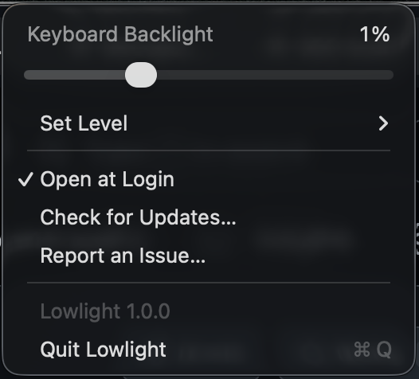

# Lowlight

Dim your MacBook keyboard backlight below the lowest setting macOS allows.

A menu bar slider with steps under the macOS minimum and the normal range above it. Pick 5, 10 or 20 steps from Steps Below Minimum in the menu (10 by default). Changing keyboard brightness in Control Center takes back over. To turn the backlight off from a step below the minimum, use Lowlight's slider.

Automatic keyboard brightness keeps working. Lowlight pauses it only while holding a step below the minimum, and turns it back on when you return to the normal range, turn the backlight off, or quit.



## Requirements

- Apple Silicon MacBook
- macOS 26

## Install

```sh
brew install --cask isaac-harper/tap/lowlight
```

Or download the latest zip from [Releases](https://github.com/Isaac-Harper/lowlight/releases/latest), unzip it, and move `Lowlight.app` to Applications.

## Updates

Lowlight checks GitHub for a new version at launch and once a day. The request carries only the app version.

## Compatibility

Tested on an M5 MacBook Air. Other Apple Silicon MacBooks should work. If yours doesn't, [open an issue](https://github.com/Isaac-Harper/lowlight/issues/new/choose) with your model.

## Build

```sh
./build.sh
open Lowlight.app
```

## How it works

macOS clamps any nonzero keyboard brightness to a PWM floor, but fades interpolate the raw duty cycle all the way to 0. Lowlight fades down, reads the live duty from the IORegistry, and holds it at the chosen step with slow fades.

Uses private CoreBrightness APIs, so a macOS update may break it.

## License

MIT
